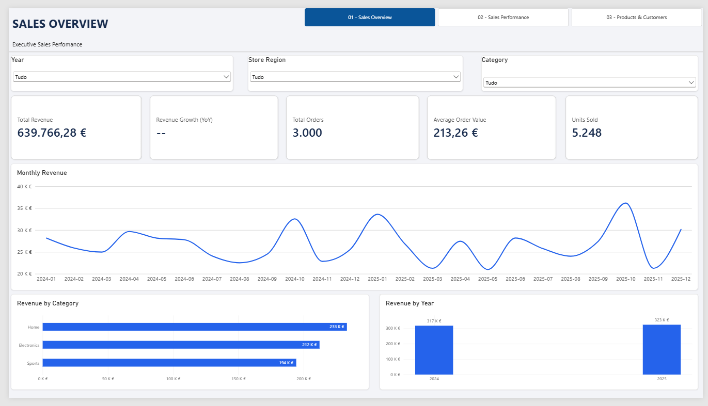
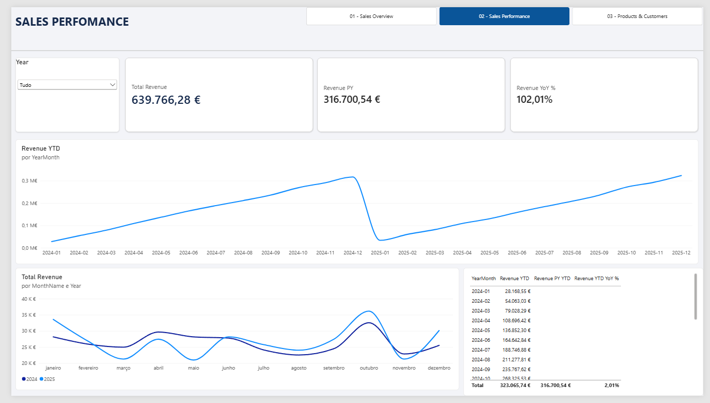
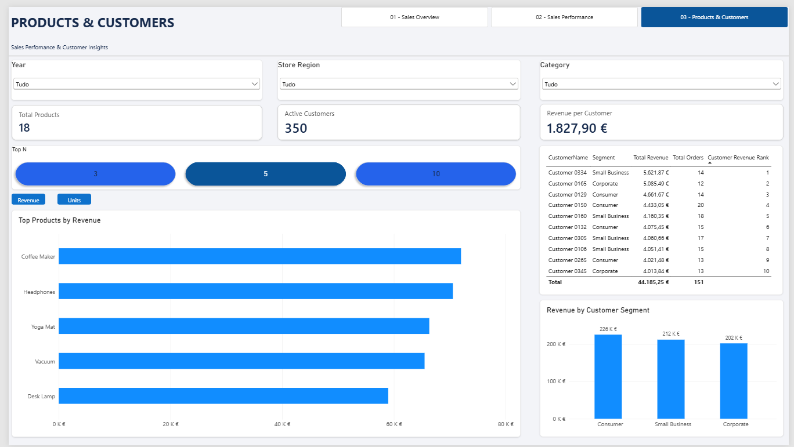
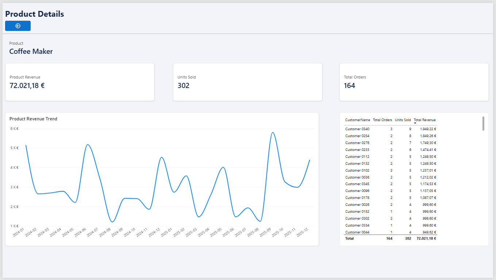
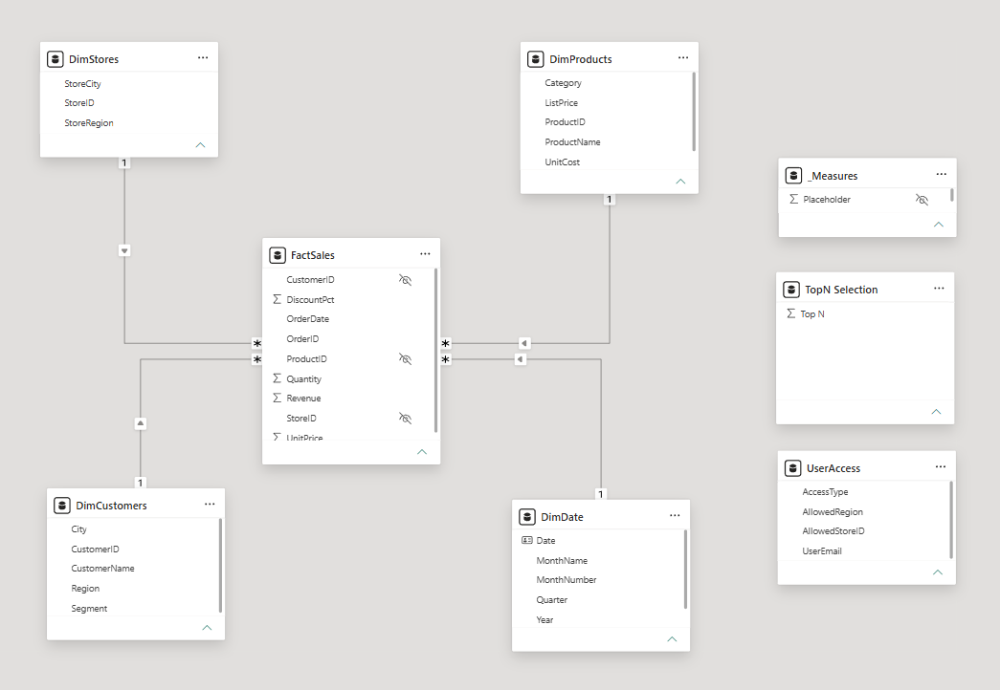

# Power BI Sales Analytics

### End-to-End Business Intelligence Portfolio Project

A Power BI project developed to analyze retail sales performance across products, customers, stores, and time periods.

The project demonstrates the complete analytical workflow, from raw data preparation and dimensional modeling to interactive dashboard development, DAX calculations, and Row-Level Security.

## Business Objectives

- Monitor overall sales performance and key business KPIs.
- Compare revenue across 2024 and 2025.
- Identify top-performing products and customers.
- Analyze sales trends and customer segments.
- Enable interactive exploration using filters, rankings, and drill-through.
- Simulate enterprise-level data access using Dynamic RLS.

## Key Results

| KPI | Value |
|---|---:|
| Total Revenue | €639,766.28 |
| Total Orders | 3,000 |
| Units Sold | 5,248 |
| Active Customers | 350 |
| Products | 18 |
| Revenue Growth (2025 vs. 2024) | +2.01% |

## Dashboards

### 1. Sales Overview

Executive dashboard showing revenue, orders, average order value, units sold, monthly trends, and revenue distribution by category.

### 2. Sales Performance

Analysis of monthly revenue, Year-to-Date performance, previous-year revenue, and year-over-year growth.

### 3. Products & Customers

Product rankings, customer analysis, revenue by segment, and interactive Top N selection.

### 4. Product Details

Drill-through page providing product-level revenue, orders, units sold, monthly performance, and customer details.

## Data Model

The solution uses a star schema consisting of:

- **FactSales:** sales transactions and revenue.
- **DimProducts:** product attributes and categories.
- **DimCustomers:** customer attributes and segments.
- **DimStores:** stores and geographical regions.
- **DimDate:** calendar dimension supporting time intelligence.

Additional tables support dynamic Top N selection and role-based data access.

## Technical Implementation

**Data Preparation:** Power Query, data type conversion, missing-value handling, duplicate removal, and calculated revenue.

**DAX:** CALCULATE, FILTER, ALL, ALLSELECTED, SUMX, DIVIDE, RANKX, TOTALYTD, SAMEPERIODLASTYEAR, and other measures.

**Visualization:** KPI cards, trend charts, rankings, slicers, bookmarks, report page tooltips, and drill-through.

**Security:** Static and Dynamic Row-Level Security using USERPRINCIPALNAME() and a fictional user-access table.

**Validation:** Reconciliation of revenue calculations, data quality checks, and role-based access testing.

## Tools

- Power BI Desktop
- Power Query
- DAX
- GitHub
- CSV datasets

## How to Run

1. Clone or download this repository.
2. Open `powerbi/Sales_Analytics_Final.pbix` in Power BI Desktop.
3. If necessary, update local CSV source paths through Power Query.
4. Refresh the data.
5. Explore the report pages and interactions.

## Notes

This project uses fictional retail data for educational and portfolio purposes.

Dynamic RLS was implemented and tested locally using Power BI Desktop. Deployment, scheduled refresh, and user-role assignment in Power BI Service were not performed.

## Author

Business Intelligence & Data Analytics Portfolio Project.
